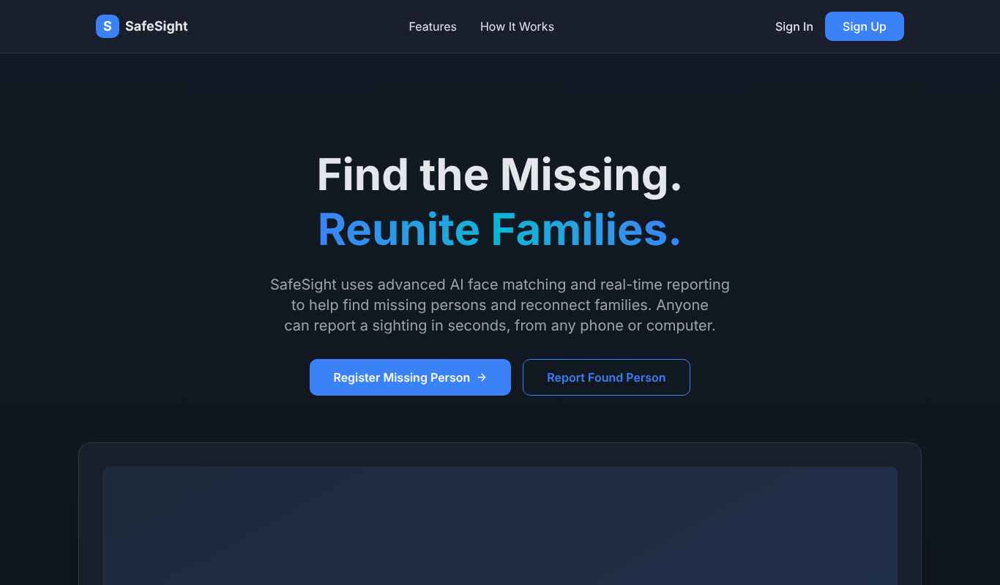
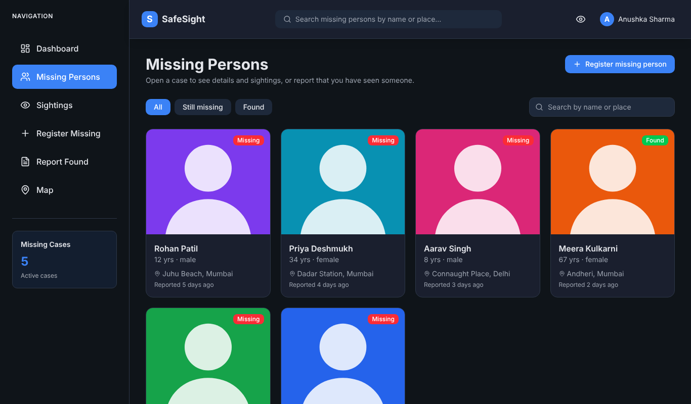
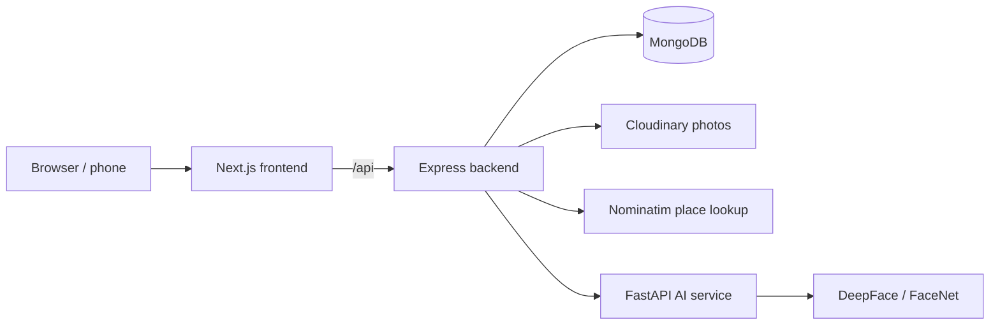

# SafeSight

A web app that helps find missing people using face recognition.

Families register a missing person with a few photos. If someone later spots a person who
might be missing, they upload a photo of them, and SafeSight compares that face with every
open case and shows the closest matches. There is also a map that shows where people went
missing and groups nearby cases into hotspots.




## What it does

- Register a missing person with photos, age, description and where they were last seen
- Report a sighting with a photo (you can take it straight from your phone camera) and get the closest matches from the face recognition model
- Press "I've seen this person" on any case to report a sighting of that specific person, with or without a photo
- Each case has its own page with photos, all linked sightings and a timeline; the person who registered it can edit it, mark it as found or delete it
- Search and filter missing persons, and browse every sighting report
- A map (Leaflet + OpenStreetMap) with red pins for missing persons, blue pins for sightings, and KMeans hotspot zones marked high, medium or low risk
- A dashboard with live counts and recent activity
- Three roles: citizen, family member and admin (admins can remove fake reports)
- Works on phones, tablets and laptops

| Dashboard | Case page |
|---|---|
|  |  |
| **Missing persons** | **Sightings** |
|  |  |


*The screenshots use sample data and placeholder pictures, not real people.*

## How the matching works

Every photo goes through FaceNet (via the DeepFace library), which turns the face into a list
of 128 numbers called an embedding. Two photos of the same person end up with similar
embeddings, so to compare faces I compare embeddings using cosine distance. If the distance
is below 0.40 it counts as a match, and the app shows at most the three closest ones. Photos
where no face can be found are rejected straight away instead of giving random results.



For the map, typed places like "Juhu Beach, Mumbai" are turned into coordinates with
OpenStreetMap's Nominatim service. The hotspots come from KMeans clustering with
k = max(1, min(5, ⌈n/3⌉)), and a zone is high risk if it has 4 or more people, medium for
2 to 3 and low for 1.

## Built with

Next.js, React, TypeScript, Tailwind CSS and Leaflet on the frontend; Node.js, Express and
MongoDB on the backend; Python, FastAPI and DeepFace for the face recognition. Photos are
stored on Cloudinary. Tests use the Node.js test runner and pytest, and GitHub Actions runs
them on every push.

## The model evaluation and the report

Before building the app, the model was evaluated on the LFW dataset (Labeled Faces in the
Wild): 1,000 pairs of faces, half of them the same person. At a threshold of 0.56 it got
94.9% accuracy, 96.1% precision, 93.6% recall and an AUC of 0.9855.
`SafeSight-AI/evaluation/lfw_eval.py` runs that evaluation again and saves all the plots.

A few things in the code are different from the original project report, on purpose:

- **Threshold.** The report picks 0.56, but that was tuned on tiny 50 x 37 greyscale images without face detection. The app works on full-size colour photos and detects the face first, so it uses DeepFace's recommended 0.40 for FaceNet. You can change it with `MATCH_THRESHOLD` in the AI service's `.env`.
- **Fairer score.** The report chose the threshold on the same pairs it reported results on. The script also gives a held-out score, where the threshold is picked on half the pairs and tested on the other half.
- **Hotspots.** One draft of the report mentioned DBSCAN, but the app uses KMeans, as described in the map section of the report.
- **Dashboard and map.** The first version showed placeholder numbers and test locations. Now everything comes from the database.

## What I changed from the first prototype

SafeSight started as a college group project. When I tested the first version I found a lot
that didn't work, so I rebuilt large parts of it. The main things:

- The matching code returned *every* registered person as a match, even at 22% similarity, because of an indentation mistake. Now only real matches are shown.
- Photos without a face were compared as whole images, and errors from the AI still showed "AI Match Completed!". Both now give a proper message.
- The database password and API keys were written in the code and public on GitHub. They are now in `.env` files that never get committed.
- Anyone could call the API without logging in, and the login response included the password hash. Now everything needs a login, roles are checked on the server, and logins expire.
- There was no way to list cases or sightings, or to edit or close a case. I added the Missing Persons and Sightings pages, the "I've seen this person" button and case editing.
- The dashboard numbers and the map were placeholder data. Both are real now, and I added the geocoding and the KMeans hotspots.
- Big phone photos timed out during upload, and some pages broke on small screens. Photos are now resized before upload, and every page works on a phone.
- There were no tests. Now there are API tests and tests for the matching logic, and they run automatically on GitHub.

## Running it locally

You'll need Node.js 20+, Python 3.10 to 3.12 (TensorFlow doesn't support 3.13+ yet), a free
[MongoDB Atlas](https://www.mongodb.com/cloud/atlas/register) database and a free
[Cloudinary](https://cloudinary.com) account. Each part runs in its own terminal.

**AI service**
```bash
cd SafeSight-AI
python -m venv .venv
.venv\Scripts\activate            # Mac/Linux: source .venv/bin/activate
pip install -r requirements.txt
copy .env.example .env            # Mac/Linux: cp. Then put your MongoDB link in .env
uvicorn main:app --port 8000
```
The first start downloads the FaceNet weights (about 90 MB). http://localhost:8000/health should say `"status":"ok"`.

**Backend**
```bash
cd SafeSight-backend
npm install
copy .env.example .env            # fill in MongoDB, a JWT secret, Cloudinary keys and an admin login
npm run create-admin
npm run dev
```

**Frontend**
```bash
cd SafeSight-frontend
npm install
npm run dev
```
Then open http://localhost:3000.

To use it from your phone, connect it to the same Wi-Fi and open the "Network" address that
`npm run dev` prints (something like `http://192.168.1.5:3000`). If the backend says it can't
connect to MongoDB, add your IP (or `0.0.0.0/0` while testing) under Network Access in Atlas.

## Tests

```bash
cd SafeSight-backend && npm test
cd SafeSight-AI && pip install -r requirements-dev.txt && pytest tests
cd SafeSight-frontend && npx tsc --noEmit && npm run build
```
The tests swap MongoDB and the face model for small fakes, so they run in a few seconds and
don't need any accounts.

## Project layout

```
SafeSight-frontend/   Next.js app
SafeSight-backend/    Express API, database models, scripts and tests
SafeSight-AI/         FastAPI face service, LFW evaluation and tests
docs/screenshots/     Images for this README
```

## Limitations

SafeSight is a student project, not a replacement for the police. In an emergency, call 112
(India). Face matches are only suggestions and can be wrong, especially with blurry, side-on
or old photos. Right now it runs locally and isn't deployed anywhere public. Please only
upload photos you have the right to share.

## Author

**Samiksha** — [@SK33Samiksha](https://github.com/SK33Samiksha)

## Acknowledgements

Started from an earlier college group prototype of SafeSight. This version was rebuilt and
extended: security fixes, working AI matching, sightings, map hotspots, mobile support,
tests and CI.

## License

[MIT](LICENSE)
