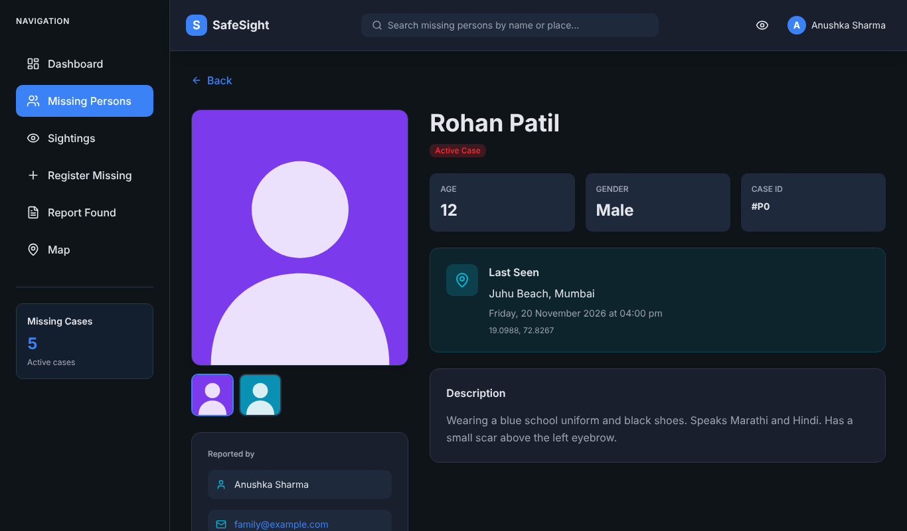
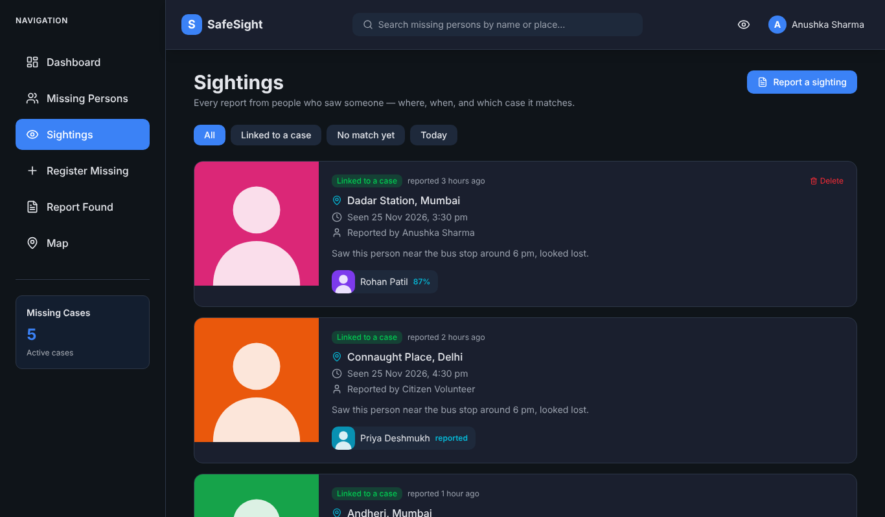
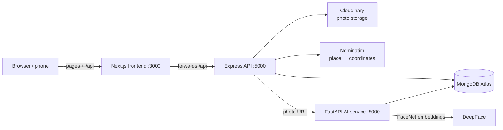

# SafeSight — AI-powered missing person identification

SafeSight is a full-stack web app that helps families and the public find missing persons.
Families register a missing person with photos. Anyone who spots someone can report a
sighting from their phone. A **FaceNet** face-recognition model compares the sighting photo
with every open case and suggests likely matches. A map with **KMeans hotspot detection**
shows where people went missing and where they were seen.


## Contents

- [Features](#features)
- [What I improved](#what-i-improved)
- [How it works](#how-it-works)
- [Tech stack](#tech-stack)
- [Model evaluation](#model-evaluation-lfw)
- [Run it on your computer](#run-it-on-your-computer)
- [Tests](#tests)
- [Project structure](#project-structure)
- [Limitations and responsible use](#limitations-and-responsible-use)

## Features

### For families
- **Register a missing person** with several photos, age, gender, description, and last-seen place and time.
- **Case page** for each person: photo gallery, last-seen details shown on the map, every sighting linked to the case, and a timeline.
- **Manage your case**: edit the details, mark the person as found (or reopen the case), or delete it.

### For the public
- **Report a sighting** with a photo. The AI immediately shows which registered people it might be.
- **"I've seen this person"** button on every case, to report where and when you saw them, with or without a photo.
- **Take a photo directly** with your phone camera. Photos are resized in the browser before upload, so it works on mobile data.

### Browse and search
- **Dashboard** with live counts, recent activity and recent AI matches. Every card and item is clickable.
- **Missing persons list** with search (by name or place) and Active / Found filters.
- **Sightings list** with photo, place, time, reporter and the case it matched, filterable by type and date.
- **Search bar** in the top navigation, available on every page.

### Map and hotspots
- **Interactive map** (Leaflet + OpenStreetMap) showing missing persons and sightings, with photo popups.
- **Place names → coordinates** automatically, using OpenStreetMap Nominatim.
- **KMeans hotspot detection** groups last-seen locations into high, medium and low risk zones.

### AI face matching
- Every photo is turned into a **128-number FaceNet embedding** using DeepFace.
- Sightings are compared with every open case by **cosine distance**. Only close matches are shown (best 3), each with a confidence score.
- **Photos without a visible face are rejected** with a clear message instead of giving false matches.

### Accounts and security
- **Roles:** citizen, family member and admin. Admins can remove fake reports.
- **JWT login** that expires, hashed passwords, and permission checks on the server.
- **Rate-limited login** against password guessing, security headers (Helmet), and **no secrets in the code**.

### Works everywhere
- **Responsive design** for phone, tablet and laptop, with a phone menu.
- **Use it from your phone** on the same Wi-Fi as the laptop running it.
- About & Privacy page, a 404 page, and clear error messages throughout.

| Dashboard | Case details |
|---|---|
|  |  |
| **Missing persons** | **Sightings** |
|  |  |

**On a phone**


*Screenshots use sample data with placeholder avatars.*

## What I improved

SafeSight started as a college group prototype. The original had a good idea and a clean
interface, but many parts were unfinished, insecure or showing made-up data. I rebuilt and
extended it into a working, tested application.

### Security

| Before | After |
|---|---|
| Database password and cloud API secret written in the source code and public on GitHub | All secrets in `.env` files that are never committed; `.env.example` templates included |
| Anyone could use every API without logging in | Every API (except sign-up and login) requires a valid login |
| Login sent the hashed password back to the browser | Password hash is never sent |
| Logins never expired | Logins expire after 7 days |
| User roles checked only in the browser (easy to fake) | Roles and ownership checked on the server |
| No way to create an admin account | `npm run create-admin` script; nobody can sign up as admin |
| No protection against password guessing | Login and sign-up rate limiting, plus security headers |
| No input checks on sign-up | Valid email, 8+ character password, no duplicate accounts |
| Uploads accepted any file of any size | Images only, 8 MB limit, login required |

### AI face matching

| Before | After |
|---|---|
| **Bug:** every registered person was returned as a "match", even at 22% similarity | Only real matches below the threshold are returned, best 3 |
| Code used a different threshold from the project report, and then ignored it | One threshold, set in `.env` (`MATCH_THRESHOLD`) |
| Photos with no face were compared as whole images, giving meaningless scores | Face detection is required; unusable photos are rejected with a message |
| If the AI failed, the app still said "AI Match Completed!" | Real error messages (no face found, AI service not running) |
| If face processing failed on registration, the person was saved but could never be matched | Registration is refused with a reason |
| Only the first photo of a person was used | Every photo is used; the best match counts |
| Model evaluation existed only in a report, not in the code | `lfw_eval.py` reproduces every metric and plot, plus a fairer held-out score |

### Features and pages

| Before | After |
|---|---|
| Dashboard numbers were hard-coded (156, 89, 23, 12) | Real numbers from the database, all clickable |
| Map showed 5 made-up people in New York, with no real map or clustering | Real Leaflet map with KMeans hotspots, filters and photo popups |
| Case page built from data in the web address; contact always "Not Available" | Loaded from the database, with reporter, photo gallery, sightings and timeline |
| No way to list missing persons or sightings | Missing Persons and Sightings pages with search and filters |
| No way to report "I saw this person" on a case | "I've seen this person" button with optional photo |
| Cases could not be edited, closed or deleted | Edit, mark as found, reopen and delete (owner or admin) |
| Fake reports could not be removed | Reporter or admin can delete a sighting |
| Search bar and notification icon did nothing | Working search; icon opens latest sightings |
| Demo login buttons that did not work | Removed; real sign-up and login |
| Locations were never placed on the map | Automatic place-to-coordinates lookup, plus a script to fix old records |

### Phones and devices

| Before | After |
|---|---|
| Floating menu button covered page content on phones | Proper ☰ menu in the top bar |
| Photo "remove" button submitted the whole form, and was invisible on phones | Fixed; always visible on touch screens |
| Large phone photos (5–10 MB) caused upload timeouts | Photos resized in the browser before upload |
| No camera option | "Take a photo" button on phones |
| Site could only be opened on the laptop running it | Works from any phone or laptop on the same Wi-Fi |
| Icons invisible (solid squares) and pages shown in a fallback serif font | Icons and fonts fixed |

### Code quality

| Before | After |
|---|---|
| No tests | Automated tests for the API and the AI matching logic |
| No automatic checks | GitHub Actions runs all tests and the build on every push |
| Type errors hidden by a build setting | Type checking turned on; builds cleanly |
| About 3,000 installed library files and a `.env` file committed to Git | Clean repository with a proper `.gitignore` |
| No README or setup instructions | This README, with screenshots and step-by-step setup |
| Server addresses hard-coded as `localhost` in many places | One setting; the website forwards API calls to the backend |

## How it works



1. **Register:** photos are uploaded to Cloudinary. The AI service detects the face in each photo and stores one embedding per usable photo.
2. **Report:** the sighting photo is embedded and compared with every open case. Pairs with cosine distance below `MATCH_THRESHOLD` (default **0.40**) count as matches; the best 3 are shown.
3. **Map:** last-seen locations are clustered with KMeans (`k = max(1, min(5, ⌈n/3⌉))`), and each cluster gets a risk level by size (4+ high, 2–3 medium, 1 low).

## Tech stack

| Layer | Technology |
|---|---|
| Frontend | Next.js 16, React 19, TypeScript, Tailwind CSS, Leaflet |
| Backend | Node.js, Express 5, Mongoose, JWT, Helmet, express-rate-limit |
| AI service | Python, FastAPI, DeepFace (FaceNet), NumPy |
| Data & storage | MongoDB Atlas, Cloudinary |
| Testing & CI | `node:test`, pytest, GitHub Actions |

## Model evaluation (LFW)

`SafeSight-AI/evaluation/lfw_eval.py` evaluates face verification on the Labeled Faces in
the Wild dataset (4,324 images, 158 people; 500 same-person and 500 different-person pairs).
It reports accuracy, precision, recall, F1, ROC-AUC, a threshold sweep and a confusion
matrix, plus a fairer **held-out** score where the threshold is tuned on half of the pairs
and tested on the other half. Plots are saved to `SafeSight-AI/evaluation/outputs/`.

```bash
cd SafeSight-AI
pip install -r requirements.txt -r evaluation/requirements-eval.txt
python evaluation/lfw_eval.py
```

## Run it on your computer

**You need:** Node.js 20+, Python **3.10–3.12** (TensorFlow does not support 3.13+ yet),
a free [MongoDB Atlas](https://www.mongodb.com/cloud/atlas/register) cluster and a free
[Cloudinary](https://cloudinary.com) account.

Open three terminals:

**1. AI service**
```bash
cd SafeSight-AI
python -m venv .venv
.venv\Scripts\activate            # macOS/Linux: source .venv/bin/activate
pip install -r requirements.txt
copy .env.example .env            # macOS/Linux: cp — then set MONGO_URI in .env
uvicorn main:app --port 8000
```
The first start downloads the FaceNet weights (about 90 MB). Check it at http://localhost:8000/health.

**2. Backend**
```bash
cd SafeSight-backend
npm install
copy .env.example .env            # set MONGO_URI, JWT_SECRET, Cloudinary keys, admin login
npm run create-admin              # creates the admin account from .env
npm run dev
```

**3. Frontend**
```bash
cd SafeSight-frontend
npm install
npm run dev
```
Open http://localhost:3000.

### Use it from your phone

With all three services running on your laptop, connect your phone to the **same Wi-Fi**
and open the **Network** address that `npm run dev` prints, e.g. `http://192.168.1.5:3000`.
If Windows asks, allow Node.js through the firewall on **private networks**.

### MongoDB network access
In Atlas → **Network Access**, add your IP address, or `0.0.0.0/0` while developing.
Otherwise the backend fails with "Could not connect to any servers".

## Tests

```bash
cd SafeSight-backend && npm test                                          # API tests
cd SafeSight-AI && pip install -r requirements-dev.txt && pytest tests    # matching logic
cd SafeSight-frontend && npx tsc --noEmit && npm run build                # type check + build
```
GitHub Actions runs all three on every push (see the **Actions** tab). The tests replace
MongoDB and the face model with small in-memory fakes, so they run in seconds and need no
accounts or internet.

## Project structure

```
SafeSight-frontend/   Next.js app (pages in app/, shared UI in components/, API client in lib/)
SafeSight-backend/    Express API (routes/, models/, middleware/, utils/, scripts/, tests/)
SafeSight-AI/         FastAPI face service (routes/, utils/embeddings.py, evaluation/, tests/)
docs/screenshots/     Images used in this README
```

| Command (in `SafeSight-backend`) | What it does |
|---|---|
| `npm run create-admin` | Creates or promotes the admin account set in `.env` |
| `npm run fix-coords` | Adds map coordinates to records that don't have them yet |
| `npm test` | Runs the API tests |

## Limitations and responsible use

- SafeSight is a student project and **does not replace the police**. In an emergency, dial **112** (India).
- Face matches are suggestions and can be wrong, especially with low-quality, side-on or old photos.
- It currently runs locally; it is not deployed on a public server.
- Only upload photos you have the right to share, and only to help find a missing person.

## Author

**Samiksha** — [@SK33Samiksha](https://github.com/SK33Samiksha)

## Acknowledgements

Started from an earlier college group prototype of SafeSight. This version was rebuilt and
extended: security fixes, working AI matching, sightings, map hotspots, mobile support,
tests and CI.

## License

[MIT](LICENSE)
