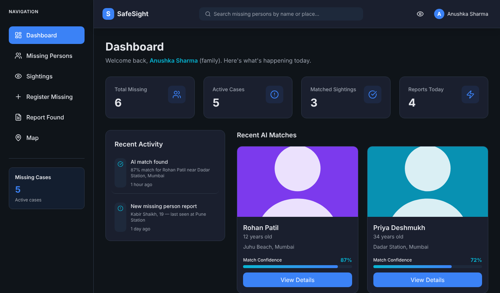
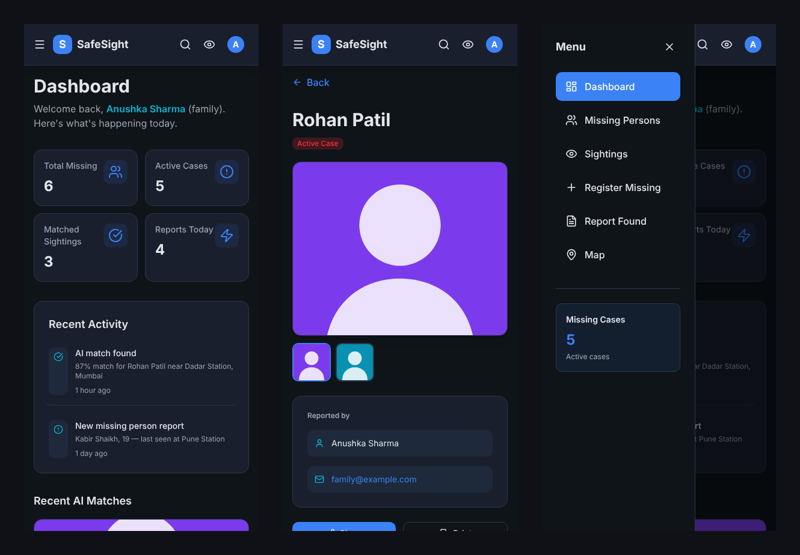
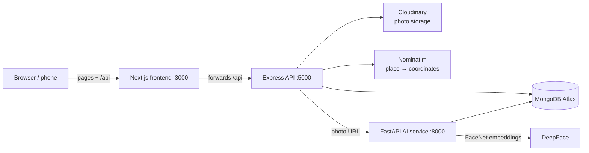

# SafeSight — AI-powered missing person identification

SafeSight is a full-stack web app that helps families and the public find missing persons.
Families register a missing person with photos. Anyone who spots someone can report a
sighting from their phone. A **FaceNet** face-recognition model compares the sighting photo
with every open case and suggests likely matches. A map with **KMeans hotspot detection**
shows where people went missing and where they were seen.


## Features

- **AI face matching**: every photo becomes a 128-number FaceNet embedding, and sightings are matched to open cases by cosine distance. Only close matches are shown, each with a confidence score.
- **Report a sighting in seconds**: upload or take a photo on a phone, or press **"I've seen this person"** on a case to add a sighting without a photo.
- **Case pages**: photo gallery, last-seen details, every sighting linked to the case, and a timeline. The reporter can edit the case, mark it found, or delete it.
- **Sightings map**: Leaflet + OpenStreetMap, place names turned into coordinates (Nominatim), and **KMeans clustering** into high, medium and low risk zones.
- **Dashboard**: live counts, recent activity and recent AI matches, all clickable.
- **Works on any device**: responsive layout with a phone menu and camera upload. Photos are resized in the browser before upload, so it works on mobile data too.
- **Accounts and roles**: citizen, family member and admin. Login uses JWT, and admins can remove fake reports.
- **Security**: hashed passwords, permission checks on the server, rate-limited login, security headers, and no secrets in the code.

| Dashboard | Case details |
|---|---|
|  |  |
| **Missing persons** | **Sightings** |
|  |  |

**On a phone**



*Screenshots use sample data with placeholder avatars.*

## How it works



1. **Register:** photos are uploaded to Cloudinary. The AI service detects the face in each photo and stores one embedding per usable photo. Photos without a face are rejected with a clear message.
2. **Report:** the sighting photo is embedded and compared with every open case. Only pairs with cosine distance below `MATCH_THRESHOLD` (default **0.40**) count as matches, best 3.
3. **Map:** last-seen locations are clustered with KMeans (`k = max(1, min(5, ⌈n/3⌉))`), and each cluster gets a risk level by size.

## Tech stack

| Layer | Technology |
|---|---|
| Frontend | Next.js 16, React 19, TypeScript, Tailwind CSS, Leaflet |
| Backend | Node.js, Express 5, Mongoose, JWT, Helmet, express-rate-limit |
| AI service | Python, FastAPI, DeepFace (FaceNet), NumPy |
| Data & storage | MongoDB Atlas, Cloudinary |
| Testing & CI | `node:test`, pytest, GitHub Actions |

## Model evaluation (LFW)

`SafeSight-AI/evaluation/lfw_eval.py` reproduces the face-verification evaluation on the
Labeled Faces in the Wild dataset (4,324 images, 158 people; 500 same-person and 500
different-person pairs). It reports accuracy, precision, recall, F1, ROC-AUC, a threshold
sweep and a confusion matrix, plus a fairer **held-out** score in which the threshold is
tuned on half of the pairs and tested on the other half. Plots are saved to
`SafeSight-AI/evaluation/outputs/`.

```bash
cd SafeSight-AI
pip install -r requirements.txt -r evaluation/requirements-eval.txt
python evaluation/lfw_eval.py
```

## Run it on your computer

**You need:** Node.js 20+, Python **3.10–3.12** (TensorFlow does not support 3.13+ yet),
a free [MongoDB Atlas](https://www.mongodb.com/cloud/atlas/register) cluster and a free
[Cloudinary](https://cloudinary.com) account.

Open three terminals:

**1. AI service**
```bash
cd SafeSight-AI
python -m venv .venv
.venv\Scripts\activate            # macOS/Linux: source .venv/bin/activate
pip install -r requirements.txt
cp .env.example .env              # Windows: copy .env.example .env  — then set MONGO_URI
uvicorn main:app --port 8000
```
The first start downloads the FaceNet weights (about 90 MB). To check it's running, open http://localhost:8000/health.

**2. Backend**
```bash
cd SafeSight-backend
npm install
cp .env.example .env              # set MONGO_URI, JWT_SECRET, Cloudinary keys, admin login
npm run create-admin              # creates the admin account from .env
npm run dev
```

**3. Frontend**
```bash
cd SafeSight-frontend
npm install
npm run dev
```
Open http://localhost:3000.

### Use it from your phone

With all three services running on your laptop, connect your phone to the **same Wi-Fi**
and open the **Network** address that `npm run dev` prints, e.g. `http://192.168.1.5:3000`.
The website forwards API calls to the backend on your laptop, so nothing else is needed.
If Windows asks, allow Node.js through the firewall on **private networks**.

### MongoDB network access
In Atlas → **Network Access**, add your IP address, or `0.0.0.0/0` while you're developing.
Otherwise the backend fails with "Could not connect to any servers".

## Tests

```bash
cd SafeSight-backend && npm test          # API: auth, permissions, cases, sightings, errors
cd SafeSight-AI && pip install -r requirements-dev.txt && pytest tests   # matching logic
cd SafeSight-frontend && npx tsc --noEmit && npm run build
```
GitHub Actions runs all three on every push (see the **Actions** tab).

The tests replace MongoDB and the face model with small in-memory fakes, so they run in
seconds and need no accounts or internet.

## Project structure

```
SafeSight-frontend/   Next.js app (pages in app/, shared UI in components/, API client in lib/)
SafeSight-backend/    Express API (routes/, models/, middleware/, utils/, scripts/, tests/)
SafeSight-AI/         FastAPI face service (routes/, utils/embeddings.py, evaluation/, tests/)
docs/screenshots/     Images used in this README
```

## Useful scripts

| Command (in `SafeSight-backend`) | What it does |
|---|---|
| `npm run create-admin` | Creates or promotes the admin account set in `.env` |
| `npm run fix-coords` | Adds map coordinates to records that don't have them yet |
| `npm test` | Runs the API tests |

## Limitations and responsible use

- SafeSight is a student project and **does not replace the police**. In an emergency, dial **112** (India).
- Face matches are suggestions and can be wrong, especially with low-quality, side-on or old photos.
- Only upload photos you have the right to share, and only to help find a missing person.

## Team

<!-- Add each team member's name, role and GitHub profile -->
- Your Name — role ([@your-github](https://github.com/your-github))

## License

[MIT](LICENSE)
